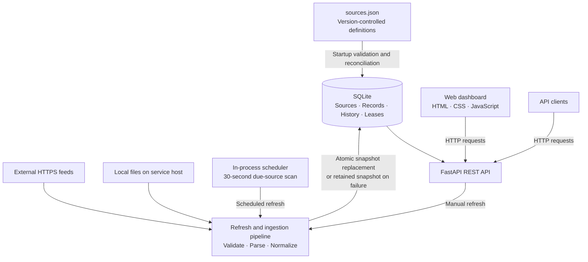

# Architecture — Booster IP Service

## Overview

Booster IP Service is a lightweight Python application that ingests IP address and CIDR lists from configured sources, validates and normalizes the data, and publishes combined results through a REST API and browser dashboard. It runs as a single service with an embedded SQLite database and an in-process refresh scheduler.

## Component diagram

## Key components

| Component | Implementation | Responsibility |
| --- | --- | --- |
| Source configuration | `sources.json`, `app/config.py` | Validates Git-managed source definitions and feed metadata |
| Database and ingestion | `app/core.py` | Initializes/migrates SQLite, reconciles sources, retrieves and parses feeds, persists snapshots and history, coordinates refresh leases |
| Data processing | `app/processing.py` | Aggregates and deduplicates CIDRs, filters address families, expands IPs for paginated responses, reports completeness |
| HTTP service | `app/main.py` | FastAPI endpoints, scheduler lifecycle, dashboard and static file hosting |
| Dashboard | `app/static/` | Displays source health and results; supports refresh, selection, formatting, copying and downloading |

## Source configuration and ingestion

The `sources.json` file is the source of truth for configured feeds. Each source has a stable ID, display name, input format, optional `cntry_origin` country code, enabled state, and optional refresh interval. Exactly one input location is required:

- **HTTPS URL** (`url`): fetched over HTTPS; credential-bearing URLs and redirects are disallowed. DNS resolution must yield only public addresses.
- **Local file** (`file_path`): read from the service host. Relative paths resolve against the directory containing `sources.json`. No file upload endpoint is provided.

Supported formats are `cidr_text` (CIDR ranges and individual addresses), `ip_text` (individual addresses), and `json` (an array of IP strings located using `json_path`).

Configuration is loaded at startup and reconciled into SQLite. Changing the input location, format, or JSON path invalidates the cached snapshot. Display-name and country-metadata changes preserve it. Removing a source removes its active records but retains its refresh history. Configuration changes require a service restart.

Each refresh reads the source, checks the size limit (10 MB), parses and validates every entry, normalizes networks, and replaces that source's cached records only after successful processing. Empty, missing, malformed, or unreachable feeds do not overwrite a previously successful snapshot. Errors and refresh attempts are recorded in history.

## Scheduling and concurrency

The application starts a background thread that checks for due sources every 30 seconds. `refresh_interval_minutes: null` disables automatic refresh; positive values from 1 to 10,080 enable it (1,440 means 24 hours). Sources can also be refreshed manually using the dashboard or API. Refreshing a local file re-reads its current contents; editing the file alone does not trigger a refresh.

In-process locks and SQLite-backed refresh leases prevent overlapping refreshes of the same source. The scheduler and manual refresh paths use the same ingestion pipeline. This design is intended for a simple single-instance deployment; multi-instance scheduling and distributed operation are not a design goal.

## Persistence and data semantics

SQLite stores source definitions and operational state, normalized per-source networks, refresh history, and refresh leases. The database is created and schema additions are applied at initialization. No separate database server is required.

Source status is:

- **pending** — no successful snapshot yet
- **ready** — a successful snapshot exists without a subsequent refresh failure
- **stale** — a successful snapshot exists, but a later refresh failed

The `complete` flag in combined data responses means every selected source has had a successful snapshot; it is not a guarantee that the data is current. Stale sources continue contributing their last successful records.

## API and dashboard

| Endpoint | Purpose |
| --- | --- |
| `GET /api/v1/health` | Service health |
| `GET /api/v1/sources` | Source configuration, status and counts |
| `GET /api/v1/sources/{source_id}/history` | Per-source refresh history |
| `POST /api/v1/sources/{source_id}/refresh` | Manual refresh |
| `POST /api/v1/sources/refresh-all` | Refresh all enabled sources |
| `GET /api/v1/data` | Combined, filtered and paginated data |
| `GET /docs` | Interactive OpenAPI documentation |
| `GET /` | Web dashboard |

The data API supports selecting sources, CIDR or individual-IP output, IPv4/IPv6 filtering, pagination, and JSON or newline-delimited plain text. The processing layer combines and aggregates networks rather than requiring callers to merge individual feeds. The dashboard is served by FastAPI and uses the same API as other clients.

Source definitions are deliberately **not** editable through HTTP endpoints; changes are managed in `sources.json`.

## Deployment and security boundaries

The application requires a Python runtime, writable persistent storage for SQLite, readable local feed files where configured, and outbound HTTPS connectivity for remote sources. It can be hosted behind a reverse proxy that provides TLS and access restrictions.

The API does not implement authentication. Deploy it only within a trusted network or behind appropriate access controls; manual refresh endpoints are also unauthenticated. Remote feed ingestion validates HTTPS destinations and rejects redirects and non-public DNS resolutions. The current 10 MB HTTP response-size check occurs after download; streaming enforcement is a potential future hardening improvement.

## Operational workflow

1. Edit and version-control `sources.json`; supply any required local feed files on the service host.
2. Deploy changes and restart the service to reconcile source configuration.
3. Manually refresh new feeds if an immediate snapshot is needed.
4. Monitor source statuses and refresh history in the dashboard or API.
5. Preserve the SQLite database across deployments to retain snapshots, history and scheduling state.

For field-level configuration and examples, see [README.md](README.md#configuring-sources).
